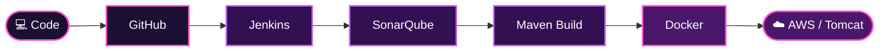

  

  

### Hello, I'm Sayali Bangar! 👋

I am an MCA graduate from Pune, Maharashtra, and an aspiring DevOps Engineer. I am passionate about learning cloud technologies, automation, and continuous integration and continuous deployment.

Currently, I am developing my practical knowledge of DevOps tools and working on hands-on projects to improve my technical skills.

- 🎓 MCA Graduate (2026)
- ☁️ Learning Cloud Computing with AWS
- 🔄 Practicing CI/CD using Jenkins
- 🐳 Learning Docker and containerization
- 🐧 Practicing Linux commands
- 🛠️ Working with Git and GitHub
- 🔍 Exploring SonarQube and Nexus
- 🚀 Interested in DevOps and Cloud Engineering opportunities

> 💜 **Currently learning:** DevOps tools, CI/CD automation, cloud infrastructure, and deployment workflows.

  

  

| Domain | Technologies |
|:---|:---|
| ☁️ Cloud | AWS (EC2 basics) |
| 🐧 Operating System | Linux |
| 🔄 CI/CD | Jenkins |
| 📦 Build Tool | Maven |
| 🐳 Containerization | Docker |
| 🔧 Version Control | Git, GitHub |
| 🔍 Code Quality | SonarQube |
| 📦 Artifact Management | Nexus |
| 🌐 Web Server | Apache Tomcat |

<table>
<tr>
<td width="50%" valign="top">

### 🚀 Jenkins CI/CD Pipeline

Jenkins-Based CI/CD Pipeline for a Java Application.

**Highlights**
- Git and GitHub source-code management.
- Maven build automation.
- Jenkins pipeline stages.
- SonarQube code-quality analysis.
- Nexus artifact management.
- Tomcat deployment workflow.
- AWS EC2 deployment concepts.

</td>

<td width="50%" valign="top">

### 🧪 Timesheet Management System

Software Testing Project.

**Highlights**
- Prepared test scenarios and test cases.
- Practiced functional testing.
- Performed integration and system testing.
- Executed test cases.
- Reported and tracked defects.
- Practiced retesting and regression testing.
- Used JIRA for defect tracking.

</td>
</tr>

<tr>
<td width="50%" valign="top">

### 🔗 API Contact List Manager

API Testing Project.

**Highlights**
- Practiced REST API testing.
- Tested CRUD operations.
- Used Postman for API requests.
- Validated response status codes.
- Worked with authentication.
- Validated API response data.
- Practiced defect tracking.

</td>

<td width="50%" valign="top">

### ☁️ AWS Cloud Learning

Hands-on practice with cloud infrastructure concepts.

**Highlights**
- Explored AWS EC2.
- Practiced cloud infrastructure basics.
- Studied application deployment.
- Explored Linux server commands.
- Learned CI/CD deployment concepts.

</td>
</tr>
</table>

  

  

  

  

  

**Interested in DevOps, Cloud Computing, and Automation? Let's connect!**

 

<a href="https://www.linkedin.com/in/sayali-bangar/">
<img src="https://img.shields.io/badge/LinkedIn-Sayali_Bangar-0A66C2?style=for
